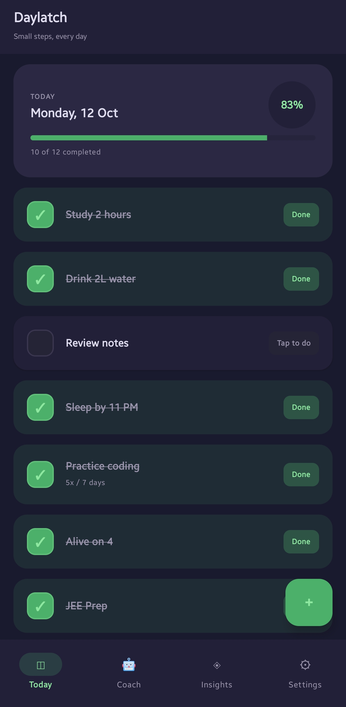
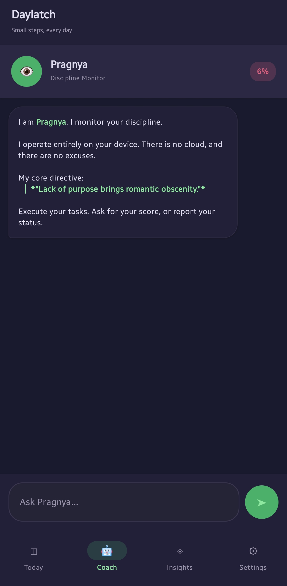
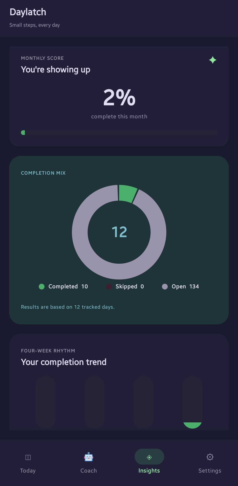
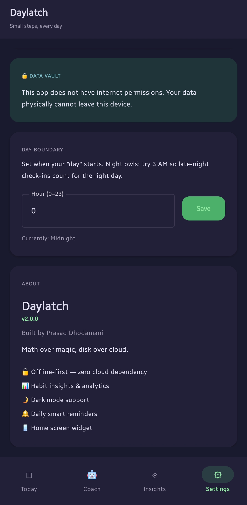

# Daylatch
> *Math over magic, disk over cloud.*

Daylatch is an offline-first, privacy-focused Android habit tracker built with modern Jetpack Compose. Your personal routines, habits, and self-improvement metrics stay strictly on your device—no accounts, no cloud sync, and zero network calls.

Daylatch includes **Pragnya**, an on-device discipline monitor designed to keep you rigorously accountable by tracking consistency and calculating performance scores mathematically.

---

## 📥 Quick Install
**[Download Daylatch v2.0.0 APK](https://github.com/prasaddhodamani910-cell/Daylatch/raw/main/Daylatch-v2.0.0.apk)**

*(Download the APK directly to your Android device, tap to install, and begin tracking immediately.)*

---

## 📸 Screenshots

| Today View | Pragnya Coach |
| :---: | :---: |
|  |  |
| **Today Tab**<br/>Daily habit dashboard displaying active routines and completion progress (e.g. 83%). | **Pragnya Discipline Monitor**<br/>Strict, on-device AI accountability coach tracking streaks, discipline status, and penalties. |

| Insights & Trends | Settings & Data Vault |
| :---: | :---: |
|  |  |
| **Insights Tab**<br/>Monthly discipline score, completion heatmaps, and detailed consistency analytics. | **Settings & Data Vault**<br/>Offline data vault controls, export/import management, reminders, and theme customization. |

---

## 🔒 Privacy-First Architecture

* **Zero Internet Permission:** Daylatch deliberately omits the `android.permission.INTERNET` permission from its Android manifest. Your data physically cannot leave your phone.
* **On-Device Database:** Powered by Android Room (SQLite) stored directly in application private storage.
* **Isolated & Backup Disabled:** `android:allowBackup="false"` ensures device-bound security, preventing unauthorized extraction through external backup utilities.
* **No Telemetry or Trackers:** No analytics SDKs, crash trackers, or third-party ads.

---

## ✨ Features

* **⚡ Modern Jetpack Compose UI:** Fluid, responsive Material 3 interface with dynamic theming and seamless Dark Mode support.
* **🤖 Pragnya AI Discipline Monitor:** An unapologetic accountability companion that rewards consistent execution and transparently highlights missed habits.
* **📊 Comprehensive Analytics:** Monthly performance index, streak milestones, and granular completion statistics.
* **📱 Home Screen Glance Widget:** Interactive widget to review and toggle daily habits directly from your home screen.
* **⏰ Exact Alarm Reminders:** Local exact alarm scheduling to alert you of daily habits without relying on remote push notifications.
* **💾 Local Data Vault:** Complete ownership of your data with JSON export and import capabilities.

---

## 🛠️ Building & Developing

### Prerequisites
* **Java Development Kit (JDK):** Version 17 (e.g. Eclipse Temurin 17)
* **Android SDK:** Compile SDK 34, Min SDK 26
* **Gradle:** 8.7 (included via Gradle Wrapper)

### Build Commands
Clone the repository and run:

```bash
# Build debug APK
./gradlew assembleDebug

# Run unit tests
./gradlew test

# Run Android Lint analysis
./gradlew lint

# Run full project build
./gradlew build
```

### Release Signing Setup
Daylatch uses externalized configuration for secure release signing:

1. Copy `keystore.properties.example` to `keystore.properties`:
   ```bash
   cp keystore.properties.example keystore.properties
   ```
2. Open `keystore.properties` and provide your keystore file path and credentials:
   ```properties
   storeFile=app/release.keystore
   storePassword=your_keystore_password
   keyAlias=your_key_alias
   keyPassword=your_key_password
   ```
3. Alternatively, supply credentials via environment variables:
   - `KEYSTORE_FILE` (or `KEYSTORE_PATH`)
   - `KEYSTORE_PASSWORD`
   - `KEY_ALIAS`
   - `KEY_PASSWORD`

*(Note: `keystore.properties` and keystore binaries are automatically ignored by git and must never be committed).*

---

## 👤 Author & Credits
* Solo Creator: **Prasad Basavaraj Dhodamani**
* Age on release: **17 years**

---

## 📄 License
**Copyright (c) 2026 Prasad Dhodamani.**

This project is licensed under a **Custom Educational License**.

* **You MAY:** Download and use the provided APK for personal use.
* **You MAY:** Read, study, and learn from the source code.
* **You MAY NOT:** Copy, modify, distribute, or use this source code for any commercial or non-commercial projects without explicit permission. The source code is provided strictly for educational reference.
